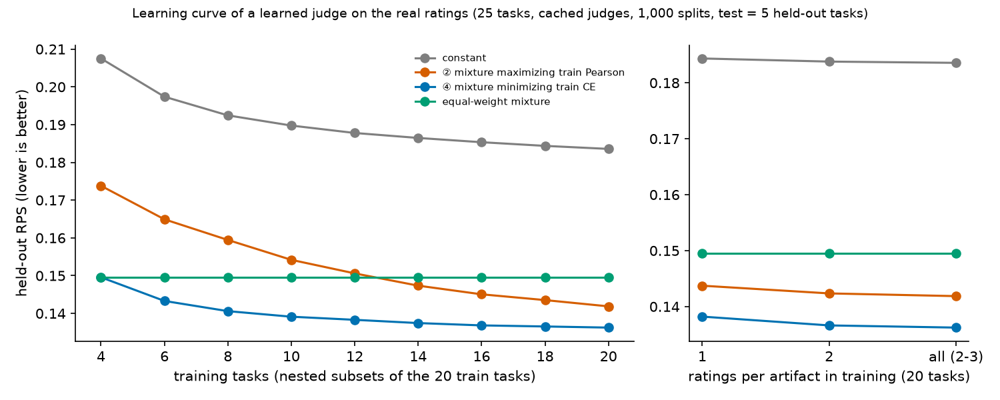

# Experiment 17 results: learning curve of a learned judge on the real human ratings

**Doc link:** <https://github.com/brando90/trustworthy-theorem-judges/blob/main/experiments/17_learning_curve_tasks_and_ratings/results.md>

**TLDR:** Held-out RPS of the CE-fitted mixture (④) falls from 0.1496 with 4 training tasks to 0.1362 with 20 (drop +0.0133 [+0.0099, +0.0169]) and is nearly flat after about 12 tasks; the Pearson-fitted mixture (②) falls more slowly, from 0.1738 to 0.1419, so ④ is ahead at small n and the gap closes by 20. Human ratings per artifact matter little at 20 tasks. Cached judges, 25 tasks, no model calls, $0.

Harness: no LLM in the loop; cached scalar ratings of five judges (VeriBench experiment 100, Vals Valkyrie harness, gpt-6-sol-high and claude-opus-5-5) fitted by a CPU script (Claude Code, Sonnet 5.5). 1000 splits (same 20/5 task splits as experiment 12); per split one random order of the 20 train tasks, the first n are the training set, so the subsets are nested. N = number of tasks and D = ratings per artifact are my reading of the whiteboard formula l = E + A N^-alpha + B D^-beta (an open question to Brando). Task bootstrap, 10,000 draws.

## Held-out RPS against training tasks (point [95% task-bootstrap interval])

| Training tasks | constant | ② mixture maximizing train Pearson | ④ mixture minimizing train CE | equal-weight mixture |
|---|---|---|---|---|
| 4 | 0.2075 [0.1787, 0.2379] | 0.1738 [0.1401, 0.2096] | 0.1496 [0.1218, 0.1788] | 0.1496 [0.1186, 0.1838] |
| 6 | 0.1974 [0.1685, 0.2279] | 0.1649 [0.1328, 0.1996] | 0.1433 [0.1169, 0.1716] | 0.1496 [0.1186, 0.1838] |
| 8 | 0.1924 [0.1636, 0.2231] | 0.1595 [0.1278, 0.1937] | 0.1406 [0.1145, 0.1686] | 0.1496 [0.1186, 0.1838] |
| 10 | 0.1898 [0.1610, 0.2204] | 0.1542 [0.1232, 0.1879] | 0.1391 [0.1133, 0.1671] | 0.1496 [0.1186, 0.1838] |
| 12 | 0.1878 [0.1588, 0.2186] | 0.1506 [0.1199, 0.1842] | 0.1383 [0.1126, 0.1662] | 0.1496 [0.1186, 0.1838] |
| 14 | 0.1865 [0.1574, 0.2173] | 0.1473 [0.1172, 0.1805] | 0.1374 [0.1119, 0.1651] | 0.1496 [0.1186, 0.1838] |
| 16 | 0.1853 [0.1562, 0.2161] | 0.1451 [0.1151, 0.1781] | 0.1368 [0.1114, 0.1645] | 0.1496 [0.1186, 0.1838] |
| 18 | 0.1844 [0.1552, 0.2152] | 0.1435 [0.1137, 0.1764] | 0.1365 [0.1112, 0.1642] | 0.1496 [0.1186, 0.1838] |
| 20 | 0.1836 [0.1544, 0.2143] | 0.1419 [0.1123, 0.1746] | 0.1362 [0.1109, 0.1638] | 0.1496 [0.1186, 0.1838] |

The absolute intervals are wide because tasks differ a lot in difficulty; they are shared across methods, so the paired differences below are the informative ones.

## Paired: ④ CE mixture minus ② Pearson mixture, RPS (negative = ④ better)

| Training tasks | difference [95% interval] |
|---|---|
| 4 | -0.0242 [-0.0333, -0.0154] |
| 6 | -0.0216 [-0.0309, -0.0126] |
| 8 | -0.0189 [-0.0293, -0.0092] |
| 10 | -0.0151 [-0.0256, -0.0053] |
| 12 | -0.0123 [-0.0238, -0.0015] |
| 14 | -0.0099 [-0.0220, +0.0013] |
| 16 | -0.0082 [-0.0204, +0.0031] |
| 18 | -0.0070 [-0.0193, +0.0044] |
| 20 | -0.0056 [-0.0181, +0.0059] |

## Drop in RPS from 4 to 20 training tasks (positive = more tasks help)

| Method | drop [95% interval] |
|---|---|
| constant (train marginal) | +0.0240 [+0.0217, +0.0260] |
| ② best single judge by train Pearson | +0.0162 [-0.0033, +0.0383] |
| ② mixture maximizing train Pearson | +0.0319 [+0.0223, +0.0425] |
| ④ best single judge by train CE | -0.0045 [-0.0169, +0.0089] |
| ④ mixture minimizing train CE | +0.0133 [+0.0099, +0.0169] |

## Other metrics at 20 training tasks

| Method | CE | TVD |
|---|---|---|
| constant (train marginal) | 1.852 | 0.6818 |
| ② mixture maximizing train Pearson | 5.787 | 0.5222 |
| ④ mixture minimizing train CE | 5.413 | 0.5098 |

## Human ratings per artifact used for training (20 tasks), RPS

| Ratings per artifact | constant | ② mixture maximizing train Pearson | ④ mixture minimizing train CE | equal-weight mixture |
|---|---|---|---|---|
| 1 | 0.1843 [0.1552, 0.2152] | 0.1437 [0.1141, 0.1765] | 0.1382 [0.1126, 0.1660] | 0.1496 [0.1186, 0.1838] |
| 2 | 0.1838 [0.1546, 0.2145] | 0.1424 [0.1127, 0.1750] | 0.1366 [0.1113, 0.1642] | 0.1496 [0.1186, 0.1838] |
| all (2 to 3) | 0.1836 [0.1544, 0.2143] | 0.1419 [0.1123, 0.1746] | 0.1362 [0.1109, 0.1638] | 0.1496 [0.1186, 0.1838] |

CE mixture, 1 rating to all: +0.0020 [+0.0010, +0.0031]; 2 ratings to all: +0.00039 [+0.00012, +0.00070]. Positive = more ratings help.

## Power-law fit RPS(n) = E + A n^-alpha (exploratory)

| Method | point E, A, alpha | bootstrap alpha p2.5, p50, p97.5 | bootstrap E p2.5, p50, p97.5 |
|---|---|---|---|
| ④ mixture minimizing train CE | 0.134, 0.088, 1.263 | 0.99, 1.26, 1.58 | 0.108, 0.134, 0.161 |
| ② mixture maximizing train Pearson | 0.046, 0.164, 0.183 | 0.10, 0.18, 0.39 | 0.000, 0.045, 0.111 |

## Plain reading

- More training tasks help both fitted mixtures, and help the loss-fitted one fastest at first: it is already near its floor at about 12 tasks. The Pearson-fitted mixture needs more tasks to get close, so at 4 to 10 tasks ④ is clearly ahead on RPS and at 14 to 20 the interval includes 0.
- With 4 training tasks the CE mixture scores the same as the equal-weight mixture (0.1496), so its gain over equal weights (about 0.013 at 20 tasks, experiment 12's result) only appears as tasks are added.
- The curves are consistent with a power law with a floor, but the floor (E about 0.13 for ④) and exponent are fitted on 9 nested subsets of one 20-task pool, so the points are strongly dependent, the interval covers task resampling only, and the exponent is not a reliable estimate of a true scaling exponent.
- At 20 tasks, 1 rating per artifact versus all 2 to 3 changes RPS by about 0.002, so within this setup the number of tasks matters more than the number of ratings per artifact.

## What was not checked

- Only 25 tasks exist; going past 20 training tasks, other judge families or a new judge search is not tested, so the curve says nothing about what more data would do beyond 20 tasks.
- Five test tasks per split, reused across 1,000 splits: the true uncertainty is wider than the splits suggest. The cached judges' prompts were developed with part of these ratings (see experiment 12).
- N and D are guesses at the whiteboard definition; the formulation's B D^-beta term is not fitted separately.
